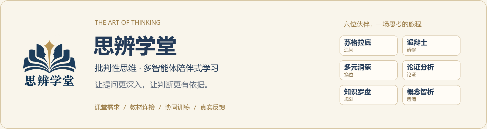
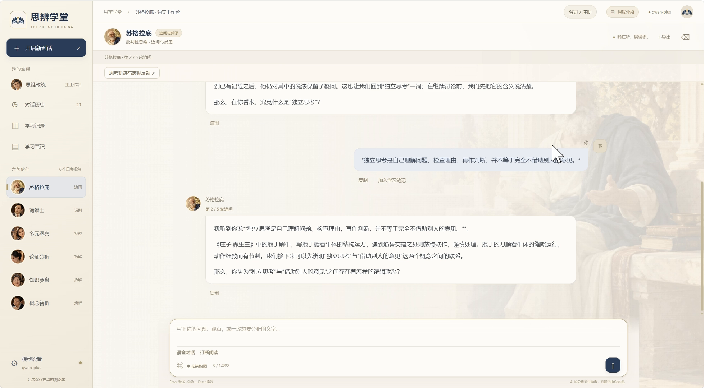
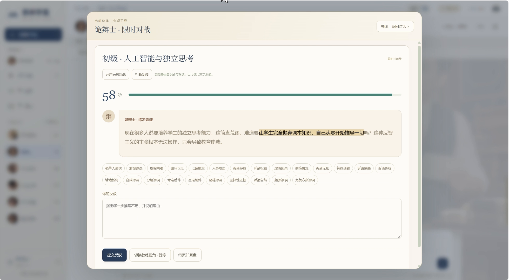
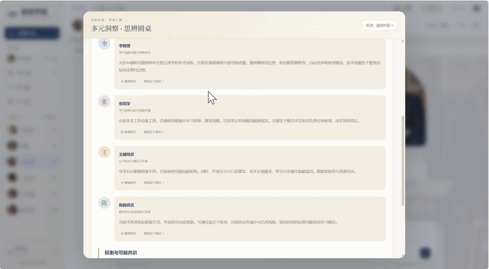
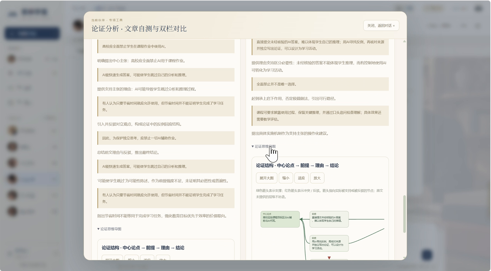
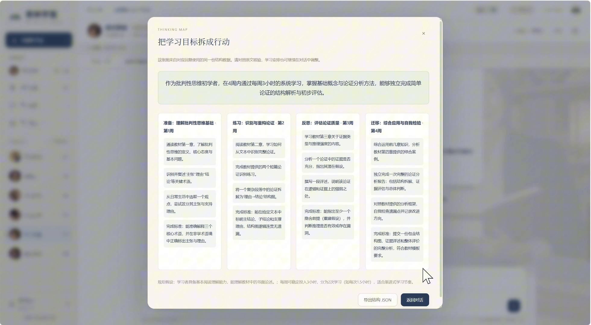
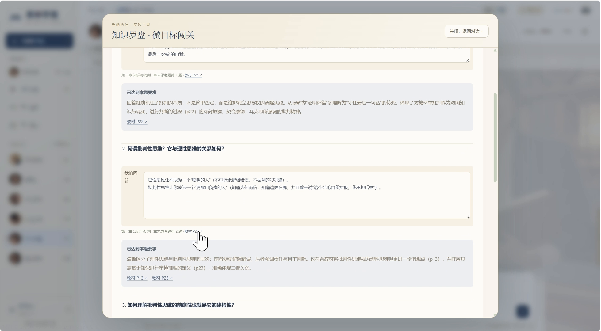
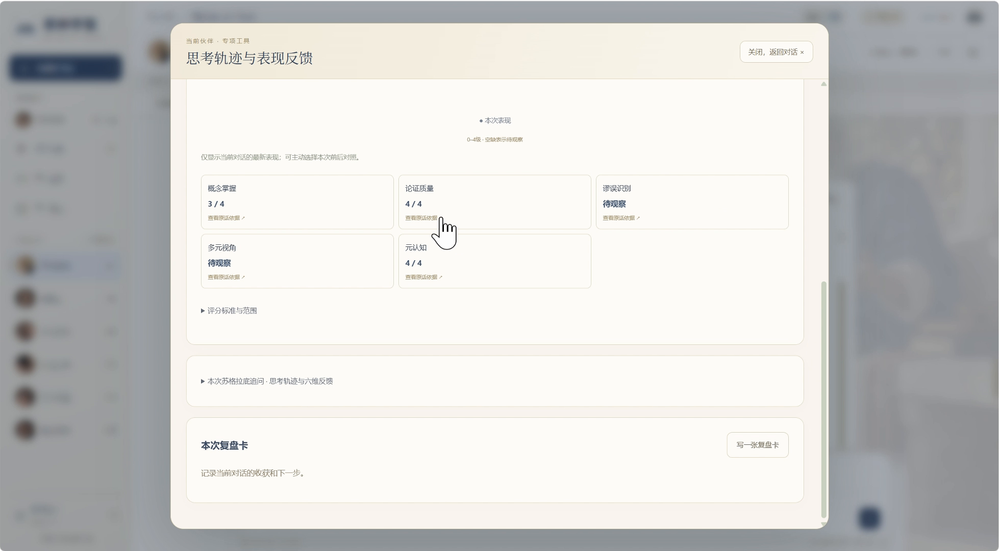

<p align="center">
  
</p>

<p align="center">
  <strong>从课堂中的一个问题，走向持续发生的思维训练。</strong><br>
  思维教练 × 六个学习伙伴 × 教材知识 × 参与式练习
</p>

<p align="center">
  <a href="https://sibianxuetang.cn/">在线演示</a> ·
  <a href="#preview">平台预览</a> ·
  <a href="#agents">六个智能体</a> ·
  <a href="#journey">项目成长</a> ·
  <a href="#architecture">技术架构</a> ·
  <a href="#quickstart">快速启动</a>
</p>

<p align="center"><sub>比赛演示按时段开放，访问码由团队单独提供。本机体验可按下方步骤启动并配置自己的模型。</sub></p>

---

## 关于思辨学堂

当学生能够获得越来越多的现成答案，如何让分析、判断与反思真正发生？

思辨学堂源于《批判性思维》课堂的学习与训练需求。我们先以小程序验证思路，再将它拓展为网页端：学生可以在主工作台提出问题，由思维教练结合上下文选择伙伴，也可以独立进入某位智能体，进行有针对性的学习。

平台围绕 **提问 → 澄清 → 论证 → 辨谬 → 换位 → 行动与复盘** 组织学习过程，保留学生回答、反驳、复述和修正的空间。

<a id="preview"></a>

## 平台预览

<a href="docs/readme/workbench.png"></a>

<p align="center"><sub>思维教练主工作台：一个问题，六种思考路径。下方截图取自项目实际界面与团队演示录屏，点击图片可查看原图。</sub></p>

## 四个学习设计

| 协同学习 | 教材连接 |
| --- | --- |
| **跟随问题与进度选择伙伴。** 自由问答、任务切换与系统训练相衔接，支持暂停和恢复。 | **让概念与课程相互连接。** 概念解释按需附上教材出处，章节闯关对应教材课后习题。 |
| **参与式训练** | **有依据的反馈** |
| 学生通过回答、复述、举例和反驳推进训练，观点在往返交流中逐步形成。 | 复盘与画像根据当前会话的真实发言生成，材料不足的维度保持“待观察”。 |

<a id="agents"></a>

## 六个学习伙伴

思维教练负责意图识别与教学编排。六个伙伴按任务调度，也可通过各自的独立工作台直接使用。

<table>
<tr>
<td width="50%" valign="top">
<h3>苏格拉底 · 追问与反思</h3>
<a href="docs/readme/socratic.png"></a>
<p>承接学生刚刚说过的话，一次提出一个聚焦问题。五轮有效回答后，回看真实观点如何变化。</p>
</td>
<td width="50%" valign="top">
<h3>诡辩士 · 识别与对抗</h3>
<a href="docs/readme/fallacy.png"></a>
<p>在案例、连续辩论与限时对战中检查推理。学生给出反驳理由，教练提供诊断与复盘。</p>
</td>
</tr>
<tr>
<td width="50%" valign="top">
<h3>多元洞察 · 换位与拓展</h3>
<a href="docs/readme/perspectives.png"></a>
<p>模拟相关角色讨论，呈现诉求、理由与价值前提，理解分歧和可能达成的共识。</p>
</td>
<td width="50%" valign="top">
<h3>论证分析 · 拆解与检验</h3>
<a href="docs/readme/argument.png"></a>
<p>从原文拆解主张、前提、理由与结论，结合批注、双栏对比及论证导图检查支持关系与缺口。</p>
</td>
</tr>
<tr>
<td width="50%" valign="top">
<h3>知识罗盘 · 规划与行动</h3>
<a href="docs/readme/planner.png"></a>
<p>结合目标、基础与时间拆解学习阶段；微目标闯关按教材章节提供原课后题与反馈。</p>
</td>
<td width="50%" valign="top">
<h3>概念智析 · 辨析与理解</h3>
<a href="docs/readme/concept.png"></a>
<p>讲清定义、边界与常见混淆，按需定位教材；适合具象化的概念配以无文字隐喻插画。</p>
</td>
</tr>
</table>

### 从练习走向复盘

<table>
<tr>
<td width="50%" valign="top">
<h4>教材章节闯关</h4>
<a href="docs/readme/chapter-practice.png"></a>
<p>以教材每章课后题组织训练，保留题目来源，并根据学生实际回答给出反馈。</p>
</td>
<td width="50%" valign="top">
<h4>当前会话表现反馈</h4>
<a href="docs/readme/learning-profile.png"></a>
<p>查看本次任务中观察到的表现与原话依据，记录收获、盲区和下一步行动。</p>
</td>
</tr>
</table>

<a id="journey"></a>

## 从课堂想法到网页平台

| 课堂需求 | 小程序验证 | 网页端拓展 |
| --- | --- | --- |
| 从批判性思维课程中的提问、概念理解与练习需求出发。 | 将六类学习伙伴带入对话场景，形成项目最初的应用。 | 丰富思维教练、教材练习、可视化、交互训练和过程反馈。 |

<details>
<summary>展开查看早期小程序与网页端界面</summary>

<table>
<tr>
<td width="30%" align="center" valign="top">
<p><strong>早期小程序 · 思路验证</strong></p>

</td>
<td width="70%" valign="top">
<p><strong>网页端 · 协同与训练拓展</strong></p>

</td>
</tr>
</table>

当前仓库以网页端实现为主，小程序图片用于说明项目来源。

</details>

<a id="architecture"></a>

## 技术架构

<a href="docs/architecture.png"></a>

| 层次 | 当前实现 |
| --- | --- |
| 网页交互 | 原生 HTML / CSS / JavaScript，主工作台与六个独立工作台，SSE 流式展示 |
| 教学编排 | 上下文意图识别、任务路由与队列、训练阶段及轮次管理、等待与暂停恢复 |
| 知识与练习 | 课程 OCR 分块、章节与页码锚定、字符二元组 TF-IDF 检索、SQLite 索引、课后习题与评价量规 |
| 模型服务 | 可配置的 OpenAI 兼容文本接口；概念图片按需调用图像生成与多模态审核 |
| 记录与访问 | 浏览器会话、笔记与画像；后端账号及积分；可选的比赛演示网关 |

多智能体协同采用任务选择与顺序编排。程序控制教学进度和结构校验，模型辅助内容生成与评阅，学生参与推动训练继续。

<a id="quickstart"></a>

## 快速启动

**运行环境：Node.js 24 或以上，使用其自带的 npm。主程序无需安装额外 npm 依赖。**

下载或克隆仓库，在仓库根目录执行：

```sh
npm start
```

打开 **http://127.0.0.1:3210/** ，在“模型设置”填写接口地址、模型名称与自己的 API Key，点击“保存并测试”。也可进入 `six-arts-web`，双击 `启动思辨学堂.cmd`。

默认预设为通义千问 `qwen-plus`，也支持配置其他兼容接口。网页填写的密钥保存在后端进程内存中，关闭服务后需重新填写。

<details>
<summary>模型配置、教材准备与可选公网演示</summary>

### 模型与概念图片

如需本机配置文件，可将 `six-arts-web/.env.example` 复制为同目录 `.env` 后填写，勿提交真实密钥。

对话、结构化分析和配图可能产生模型服务费用。概念配图按需生成并审核，服务不可用时省略图片，文字回答继续显示。接口地域、模型权限及费用以实际使用的服务为准。

### 教材资料

- `six-arts-web/data/textbook-pages.json` 是项目整理的课程 OCR 检索数据，SQLite 索引由本机程序建立。
- 教材原 PDF 未随仓库提供。需要打开教材原页时，按 [资料放置说明](resources/README.md) 将课程文件放到 `resources/`。
- 未放入主教材 PDF 时，文本对话及现有检索数据可以使用，但“打开教材原页”不能使用。
- 教材出处重点用于概念解释与用户索要来源的场景，不为每次回答强行添加页码。

### 可选公网演示

详见 [比赛演示使用说明](demo-access/使用说明.md)。执行：

```sh
npm run demo
```

本机模型管理页为 http://127.0.0.1:3212/ ，演示网关为 http://127.0.0.1:3211/ 。首次启动在本机生成访问码，需另外配置模型、域名与隧道。电脑保持开机、联网和服务运行后，评审才能持续访问。

GitHub 用于保存与展示源码，上传代码本身不会启动 Node.js 教学后端。

</details>

<details>
<summary>项目目录与测试方法</summary>

### 项目目录

```text
.
├─ six-arts-web/          网页端与教学后端
│  ├─ public/            页面、Logo、导师场景与交互
│  ├─ agents.mjs         角色与基础提示
│  ├─ training.mjs       意图路由、任务队列与教学状态
│  ├─ features.mjs       练习、对战、论证工具与画像接口
│  ├─ textbook.mjs       教材分块、检索与索引
│  ├─ concept-illustrations.mjs  按需配图与审核
│  ├─ data/              课程 OCR 检索文本
│  └─ test/              状态、接口及教学约束测试
├─ demo-access/           可选比赛演示网关
├─ resources/             自行准备的教材 PDF 放置位置
└─ docs/                  总体方案、界面截图与说明
```

### 检查与测试

在根目录执行：

```sh
npm test
```

此命令执行代码与接口检查，排除依赖未随仓库提供的课程原 PDF 的两项测试。测试使用模型替身与测试数据，无需真实 API Key。

准备齐 `course-library.mjs` 中的课程资料后，可执行完整测试：

```sh
npm run test:full
```

演示网关检查：

```sh
node --test demo-access/gateway.test.mjs
```

</details>

## 数据、素材与开源范围

- 会话、笔记和画像保存在当前浏览器；后端保存账号、积分及练习状态。
- 仓库不包含真实模型密钥、账号数据、比赛访问码、课本原 PDF 或小程序端源码。
- 界面图用于说明平台功能；画像呈现当前任务中观察到的表现，不代表经独立实验验证的能力增长。
- 教材 OCR、引文、习题与界面素材的来源及使用范围与自编代码分别说明，详见 [仓库范围](docs/开源范围说明.md)。
- 开源许可证尚待团队确认并补充，以仓库实际 LICENSE 文件为准。

---

<p align="center"><strong>给思考留一点空间。</strong><br><sub>“我为什么这样认为？”有时候，比“答案是什么”更值得停下来想一想。</sub></p>
