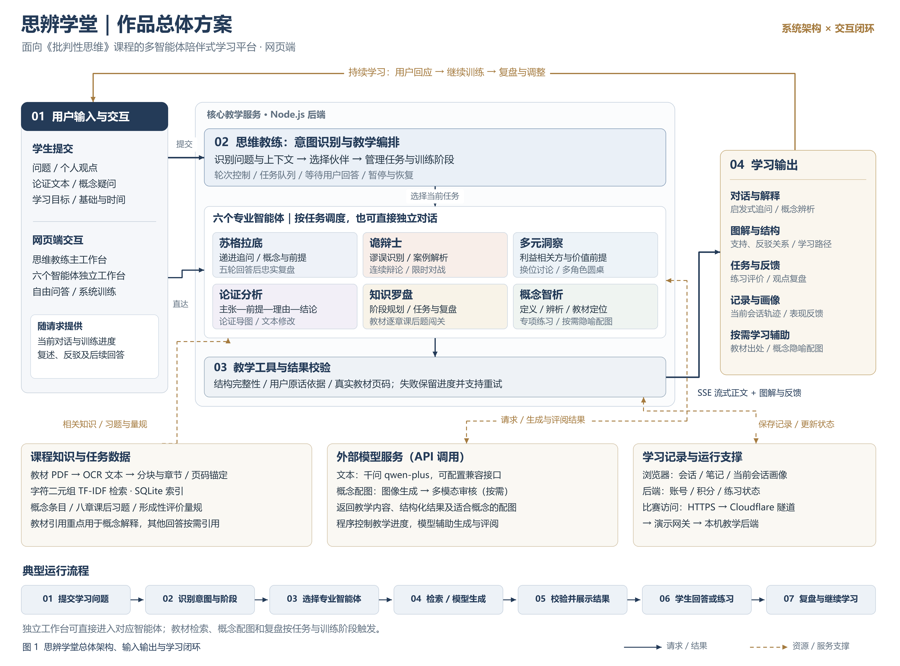

# 思辨学堂

面向《批判性思维》课程的多智能体陪伴式学习平台。

项目源于课堂学习与训练需求，首先通过小程序验证思路，随后拓展为网页端。当前仓库以网页端为主，包含思维教练主工作台、六个独立智能体及课程训练工具。



## 六个学习伙伴与主工作台

| 入口 | 主要功能 |
| --- | --- |
| 思维教练 | 根据问题、上下文与当前训练阶段调度伙伴；支持自由问答和系统训练 |
| 苏格拉底 | 逐轮承接用户观点、聚焦追问；五轮有效回答后回顾真实观点变化 |
| 诡辩士 | 谬误判断、案例解析、连续辩论和限时对战 |
| 多元洞察 | 呈现利益相关方立场与价值前提，支持换位讨论和模拟圆桌 |
| 论证分析 | 拆解主张、前提、理由与结论；生成支持及反驳关系导图与修改建议 |
| 知识罗盘 | 制定阶段学习计划，按教材八章课后题进行微目标闯关 |
| 概念智析 | 定义、易错辨析、按需教材出处与专项练习；适合的概念可配隐喻插画 |

多智能体采用意图路由与任务编排，按学习任务选择和切换角色。各独立工作台可单独对话。系统还支持思考轨迹、当前会话表现反馈、跨角色笔记、账号积分和排行榜。

## 运行要求

- Node.js 24 或以上，使用其自带的 npm。
- 支持 OpenAI 兼容接口的文本模型服务。项目默认预设为通义千问 `qwen-plus`，可在界面配置。
- 主程序使用 Node.js 内置模块，无需安装额外 npm 依赖。

## 本机启动

下载或克隆仓库后，在仓库根目录执行：

```sh
npm start
```

打开 http://127.0.0.1:3210/ ，在“模型设置”中填写接口地址、模型名称及自己的 API Key，点击“保存并测试”。也可以进入 `six-arts-web`，双击 `启动思辨学堂.cmd`。

网页填写的模型密钥保存在后端进程内存中，关闭服务后需重新填写。如需使用本机配置文件，可把 `six-arts-web/.env.example` 复制为同目录 `.env` 并填写；该文件不要提交到仓库。

对话、结构化分析和图片功能可能产生模型服务费用。概念图片按需使用图像生成和多模态审核；生图不可用时省略图片，文字回答继续显示。模型接口权限与费用以所使用服务为准。

## 教材与知识连接

- `data/textbook-pages.json` 提供项目整理的 OCR 检索文本；采用字符二元组 TF-IDF 与余弦相似度检索，SQLite 保存索引。
- 教材原 PDF 未随仓库提供。需要在网页打开教材原页时，按 [资料放置说明](resources/README.md) 将课程文件放到 `resources/`。
- 未放入主教材 PDF 时，文本对话和基于现有检索数据的教学可以启动，但“打开教材原页”不能使用。
- 概念解释与用户索要来源时按需显示真实教材出处；不是每次回答都附上章节页码。
- 课程 OCR、教材引文和习题的来源及使用范围与自编代码分别管理，详见 [仓库范围](docs/开源范围说明.md)。

## 项目结构

```text
.
├─ six-arts-web/          网页端与教学后端
│  ├─ public/            页面、样式、Logo 与导师图
│  ├─ agents.mjs         六个角色及思维教练配置
│  ├─ training.mjs       意图路由、任务队列和教学状态
│  ├─ features.mjs       练习、对战、论证工具与画像等接口
│  ├─ textbook.mjs       教材分块、稀疏检索与索引
│  ├─ concept-illustrations.mjs  按需隐喻配图及审核
│  ├─ data/              课程 OCR 检索文本
│  └─ test/              状态、结构、接口与教学约束测试
├─ demo-access/           可选的比赛公网演示网关
├─ resources/             自行准备的教材 PDF 放置目录
└─ docs/                  总体方案图与仓库范围说明
```

## 检查与测试

根目录执行：

```sh
npm test
```

此命令执行代码与接口测试，跳过依赖未随仓库提供的课程原 PDF 的两项检查。测试不需要真实 API Key，使用测试数据或模型替身。

准备齐 `course-library.mjs` 的课程文件后执行完整测试：

```sh
npm run test:full
```

比赛演示网关检查：

```sh
node --test demo-access/gateway.test.mjs
```

## 可选的公网演示

本机 `3210` 是本地学习入口。需要比赛评审通过公网体验时，可使用 `demo-access` 的受保护网关，详见 [演示使用说明](demo-access/使用说明.md)。

执行 `npm run demo` 后，本机模型管理页为 http://127.0.0.1:3212/ ，演示网关为 http://127.0.0.1:3211/ 。需独立配置模型、域名及隧道；首次启动会在本机生成演示访问码。源码不包含团队正在使用的访问码和账号数据。

电脑需保持开机、联网和服务运行。GitHub 仓库用于保存与展示源码，本项目的 Node.js 教学后端不会因为上传代码而自动运行。

## 数据保存与已知范围

- 会话、笔记和画像保存在当前浏览器；后端保存账号、积分及练习状态，重启后模型密钥需要重新配置。
- 输出校验覆盖结构、用户原话依据、页码和流程约束，不能保证模型所有事实和教学判断始终正确。
- 当前仓库不包含小程序端源码、完整第三方 PDF、实际使用记录和演示视频。
- 开源许可证尚待团队确认并补充；请先查阅 [仓库范围说明](docs/开源范围说明.md)。
